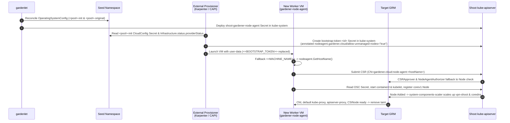

# GEP-0079: Nodeless Shoot clusters with hosted control plane

## Summary

Gardener treats `len(shoot.spec.provider.workers) == 0` as a single switch (`IsWorkerless`) that disables both `machine-controller-manager` (MCM) and the entire node-capable control plane: cloud credentials, `Infrastructure`, `ControlPlane` (CCM and CSI controllers), `Network` (CNI), `kube-scheduler`, `kube-proxy`, `coredns`, `vpn-seed-server`, `vpn-shoot`, `apiserver-proxy`, `gardener-node-agent`, and workload API groups (`apps/v1`, `batch/v1`, `autoscaling/v2`, `policy/v1`). Conversely, any Shoot that enables cloud infrastructure, networking, and scheduling must define at least one MCM worker pool with `maximum > 0` and `systemComponents.allow: true`, and must keep at least one node running at all times so `vpn-shoot`, `coredns`, and `metrics-server` can run inside the Shoot.

This GEP separates "node-capable Shoot cluster" from "MCM-managed worker pools" and "currently running nodes". A Shoot with cloud credentials and networking can now omit `spec.provider.workers` or set all worker pools to `minimum: 0`, including `maximum: 0` OS template pools. When zero `Node` objects exist in the Shoot, `gardener-resource-manager` (GRM) scales in-cluster system Deployments (`vpn-shoot`, `coredns`, `metrics-server`, `blackbox-exporter`) to zero replicas, and scales them back up as soon as the first `Node` registers. Existing workerless and worker-based Shoots keep their exact behavior.

## Motivation

In Gardener's hosted control plane model, `etcd`, `kube-apiserver`, `kube-controller-manager`, `kube-scheduler`, `gardener-resource-manager`, and provider extensions already run in the Seed cluster. A Shoot cluster with zero worker nodes needs only its Seed pods and basic cloud network infrastructure (networks, subnets, security groups, and routing).

Today, three coupling points in `gardener/gardener` prevent running a node-capable Shoot at zero nodes or with external node provisioners such as Karpenter, Cluster API, or KEDA-driven scale-from-zero:

1. **`IsWorkerless` conflates API-only control planes with zero-worker-pool clusters.**
   In `pkg/api/core/v1beta1/helper/shoot.go`, `IsWorkerless(shoot)` returns `len(shoot.Spec.Provider.Workers) == 0`. When `workers` is empty, `ValidateShootSpec` in `pkg/api/core/validation/shoot.go` forbids `credentialsBindingName`, `secretBindingName`, `provider.infrastructureConfig`, `provider.controlPlaneConfig`, `networking.{type,pods,nodes,providerConfig}`, `kubernetes.{kubeScheduler,kubeProxy,kubelet,clusterAutoscaler,verticalPodAutoscaler}`, and `systemComponents`. In `pkg/component/kubernetes/apiserver/deployment.go`, `kube-apiserver` disables `apps/v1`, `batch/v1`, `autoscaling/v2`, `policy/v1`, and `storage.k8s.io/v1/csinodes`, and omits the `Node` authorizer and kubelet client certificates. A cluster owner who wants a full Kubernetes control plane with cloud infrastructure, CCM, CSI, and CNI where nodes are provisioned outside MCM cannot omit `spec.provider.workers`.

2. **Shoot reconciliation and care health checks require at least one running Shoot node.**
   Even if a user defines a worker pool with `minimum: 0, maximum: N, systemComponents.allow: true`, the Shoot cannot stay at 0 nodes:
   * `ReconcileVPNComponentsTaskGroup` in `pkg/gardenlet/operation/botanist/flow.go` calls `VPNShoot.Wait(ctx)` with a 2-minute timeout waiting for the `vpn-shoot` Deployment in `kube-system` to become `Available`, and `WaitUntilTunnelConnectionExists` in `pkg/gardenlet/controller/shoot/shoot/reconciler_reconcile.go` waits up to 15 minutes for a running `vpn-shoot` pod and port-forward on port 22.
   * In-cluster system components (`vpn-shoot`, `coredns`, `metrics-server`, `blackbox-exporter`) run as `Deployment`s or `StatefulSet`s with `replicas >= 1` in `kube-system`. When `cluster-autoscaler` or Karpenter sees these `Pending` pods, it scales the cluster from 0 to 1 node even when no user workloads exist.
   * When 0 nodes exist, GRM marks `shoot-core-vpn-shoot`, `shoot-core-coredns`, and `shoot-core-metrics-server` as `ResourcesHealthy: False` and `ResourcesProgressing: True`, and the `gardenlet` Care controller in `pkg/gardenlet/controller/shoot/care/health.go` fails `SystemComponentsHealthy` with `DeploymentUnhealthy` and `TunnelConnectionBroken`.

3. **Node bootstrapping (`OperatingSystemConfig`, `gardener-node-agent`, CSR approval, and `node-agent-authorizer`) requires MCM `Machine` objects.**
   * Whenever `b.Shoot.HasManagedInfrastructure()` is true, `gardenlet` configures Target GRM with `values.MachineNamespace = b.Shoot.ControlPlaneNamespace` in `pkg/gardenlet/operation/botanist/resource_manager.go`. When `MachineNamespace != nil`, both `csr-approver` in `pkg/resourcemanager/controller/csrapprover/reconciler.go` and `node-agent-authorizer` in `pkg/resourcemanager/webhook/nodeagentauthorizer/authorizer.go` reject CSRs and API requests from any `gardener-node-agent` or `kubelet-serving` CSR that does not have a matching `machine.sapcloud.io/v1alpha1.Machine` object in the Seed namespace.
   * `nodeinit.Config` in `pkg/component/extensions/operatingsystemconfig/nodeinit/nodeinit.go` writes literal `<<MACHINE_NAME>>` and `<<BOOTSTRAP_TOKEN>>` placeholders into `/var/lib/gardener-node-agent/`, relying on MCM's `machine-controller` in `pkg/util/provider/machinecontroller/userdata.go` to mutate user-data per VM.
   * `kube-proxy` and `node-local-dns` DaemonSets are rendered per `(worker.gardener.cloud/pool, worker.gardener.cloud/kubernetes-version)` pair. If an external provisioner joins a node without `worker.gardener.cloud/pool`, no `kube-proxy` pod schedules on that node until the next Shoot reconciliation, leaving the node tainted with `node.gardener.cloud/critical-components-not-ready:NoSchedule`.

### Goals

1. Allow creating and operating a node-capable Shoot cluster (`Infrastructure`, `ControlPlane`, `Network`, `kube-scheduler`, `gardener-resource-manager`, workload APIs) with `spec.provider.workers` empty (`[]`) or with all worker pools set to `minimum: 0`, including `maximum: 0` OS template pools.
2. Keep 100% backwards compatibility for existing workerless Shoots and existing MCM-managed Shoots.
3. Allow a node-capable Shoot to reconcile, hibernate, migrate, delete, and report `SystemComponentsHealthy = True` and `EveryNodeReady = True` when zero `Node` objects exist in the Shoot, without `Pending` `kube-system` pods triggering autoscaler scale-up from zero.
4. Allow external node provisioners such as Karpenter or Cluster API to bootstrap nodes using Gardener's `OperatingSystemConfig` and `gardener-node-agent` without MCM `Machine` objects in the Seed.

### Non-goals

1. Replacing `machine-controller-manager` or `cluster-autoscaler` and `scaling-advisor` (`GEP-0037`) as Gardener's built-in node management stack.
2. Supporting zero nodes for self-hosted Shoot clusters (`GEP-0028`).
3. Changing the behavior of API-only workerless Shoots (`spec.networking.type == nil` and no cloud credentials).
4. Adding Karpenter, KEDA, or Cluster API controllers into `gardener/gardener` core. Those belong in separate Gardener extensions or user deployments that consume the contracts in this GEP.

## Proposal

### 1. Narrow `IsWorkerless` and introduce `HasMCMWorkers`

We separate "is this Shoot an API-only control plane?" from "does this Shoot have MCM-managed worker pools?" using existing fields on `ShootSpec`. No new CRD or top-level API field is needed.

* **`IsWorkerless(shoot)`** in `pkg/api/core/v1beta1/helper/shoot.go` is true only when `len(shoot.Spec.Provider.Workers) == 0` AND `!HasManagedInfrastructure(shoot)` AND `shoot.Spec.Networking == nil || shoot.Spec.Networking.Type == nil`.
* **`HasMCMWorkers(shoot)`** is true when at least one entry in `shoot.Spec.Provider.Workers` has `Maximum > 0`.

When a Shoot sets cloud credentials via `credentialsBindingName` or `secretBindingName` and sets `spec.networking.type`:
* `spec.provider.workers` may be omitted or empty, or
* `spec.provider.workers` may contain pools with `minimum: 0, maximum: 0`, which act as OS and kubelet templates that generate `OperatingSystemConfig` CRs and `shoot-gardener-node-agent` Secrets without deploying MCM, `Worker`, or `cluster-autoscaler`, or
* `spec.provider.workers` may contain MCM pools with `minimum: 0, maximum: N`.

### 2. Scale in-cluster system Deployments to zero when no nodes exist

`kubelet` and `gardener-node-agent` connect inbound from the worker VM to the Seed's external `kube-apiserver` endpoint. They do not need `vpn-shoot` or `coredns` to register a `corev1.Node` object.

We add a `system-components-scaler` controller to Target `gardener-resource-manager`:
* When `len(nodes) == 0` in the Shoot cluster, GRM scales `Deployment`s and `StatefulSet`s in `kube-system` labeled `resources.gardener.cloud/scale-to-zero-when-no-nodes: "true"` (`vpn-shoot`, `coredns`, `coredns-autoscaler`, `metrics-server`, `blackbox-exporter`) to `0` replicas.
* Because `spec.replicas == 0`:
  * No `Pending` pods exist in `kube-system` to trigger unwanted scale-from-zero in `cluster-autoscaler`, `scaling-advisor`, or Karpenter.
  * GRM's existing `CheckDeployment` and `CheckStatefulSet` health checks in `pkg/utils/kubernetes/health/` report `ResourcesHealthy = True` and `ResourcesProgressing = False`.
* As soon as the first `corev1.Node` object registers in the Shoot API server, GRM restores `spec.replicas` on those `Deployment`s and `StatefulSet`s while the node is still initializing its CNI DaemonSet (`node.gardener.cloud/critical-components-not-ready`).
* In `gardenlet`, `VPNShoot.Wait` and `WaitUntilTunnelConnectionExists` during Shoot reconciliation, as well as `CheckTunnelConnection` in Shoot Care (`SystemComponentsHealthy`), are skipped when `len(nodes) == 0` and all worker pools have `minimum == 0`.

### 3. Reuse existing unmanaged-node logic in `gardener-node-agent` and GRM

`gardener-resource-manager` already has a complete `Node`-based authorization and CSR approval path for nodes without MCM `Machine` objects, implemented for `gardenadm` self-hosted shoots when `machineNamespace == nil` in `pkg/resourcemanager/controller/csrapprover/reconciler.go` and `pkg/resourcemanager/webhook/nodeagentauthorizer/authorizer.go`.

Instead of inventing a new identity system:
1. **Fallback in `csr-approver` and `node-agent-authorizer`.** When `MachineNamespace != nil`, if a `machine.sapcloud.io/v1alpha1.Machine` object exists for `<machineName>`, GRM validates against the `Machine` object as today. If no `Machine` object exists, GRM falls back to its existing `Node`-based check: it verifies the bootstrap token, checks that no `Node` with `<machineName>` already has an active `gardener-node-agent` Lease, and scopes access to that `Node` and its `worker.gardener.cloud/gardener-node-agent-secret-name` label.
2. **Hostname fallback in `gardener-node-agent`.** In `cmd/gardener-node-agent/app/app.go` (`fetchMachineNameFromFile`), if `/var/lib/gardener-node-agent/machine-name` still contains the unreplaced `<<MACHINE_NAME>>` placeholder, `gardener-node-agent` falls back to `nodeagent.GetHostName()`.
3. **Default `kube-proxy` DaemonSet.** `gardenlet` deploys a default `kube-proxy` DaemonSet matching nodes where `worker.gardener.cloud/pool` `DoesNotExist`, so externally provisioned nodes without pool labels immediately pass `node-critical-components` readiness checks.

### Notes, constraints, and caveats

* **Controllers that trigger scale-from-zero must run in the Seed or externally.**
  When a Shoot has 0 nodes, no pods run inside the Shoot. Any controller responsible for scaling the cluster from 0 to 1 node, such as `cluster-autoscaler`, a Seed-hosted Karpenter extension, a CAPI controller, or a KEDA operator scaling Shoot Deployments from 0 to 1, must run in the Shoot's control plane namespace on the Seed. In the Seed namespace it can also mount the Shoot's `cloudprovider` or `workload-identity-ref-*` Secret (`GEP-0026`) and read `Infrastructure.status.providerStatus`. Users who install Karpenter or KEDA inside the Shoot cluster itself must either keep a 1-node base pool or trigger the initial 0-to-1 node creation externally.
* **In-cluster webhooks at zero nodes.**
  When 0 nodes exist, the `vpn-shoot` tunnel is inactive and no pods run in the Shoot. Gardener's own webhooks (GRM and extension controlplane webhooks) run in the Seed and work at 0 nodes. User-installed webhooks whose backing Service runs inside the Shoot are unreachable at 0 nodes. Workloads that scale from zero should use CEL `ValidatingAdmissionPolicy` and `MutatingAdmissionPolicy`, which `kube-apiserver` evaluates in-process, or Seed-hosted webhooks rather than in-cluster webhook pods with `failurePolicy: Fail`.

### Risks and mitigations

| Risk | Likelihood | Impact | Mitigation |
|---|---|---|---|
| `vpn-shoot`, `coredns`, or `metrics-server` pods block scale-down of the last node | High | High | Mark these pods with `cluster-autoscaler.kubernetes.io/safe-to-evict: "true"` and do not set `karpenter.sh/do-not-disrupt`. Once the last `Node` object is deleted, GRM's `system-components-scaler` scales their `Deployment`s/`StatefulSet`s to `0` so they do not re-trigger scale-up. |
| Weakening `node-agent-authorizer` or `csr-approver` for MCM shoots | Low | High | Only enable the `Node`-based fallback in `csr-approver` and `node-agent-authorizer` when the bootstrap token Secret in `kube-system` is explicitly annotated with `nodeagent.gardener.cloud/allow-unmanaged-nodes: "true"` (or for pools with `maximum: 0`). Standard MCM bootstrap tokens continue to require a matching `Machine` CR in the Seed. |
| Masking broken VPN tunnels when a Shoot expects nodes | Low | High | `HasExpectedNodes` only skips `VPNShoot.Wait` and `CheckTunnelConnection` when `len(nodes) == 0` AND all worker pools have `minimum == 0`. If `len(nodes) > 0` or any pool has `minimum > 0`, tunnel checks fail as today. |
| Orphaned cloud VMs on Shoot deletion when external provisioners are used | Medium | Medium | Extensions managing external nodes (`BeforeKubeAPIServer` deletion lifecycle) must delete their instances before `Infrastructure` teardown. |

## Design details

### 1. API and helper changes

#### 1.1 Helpers (`pkg/api/core/v1beta1/helper/shoot.go`)

No new fields are added to `ShootSpec`. Existing fields express all combinations:

```go
// IsWorkerless checks if the shoot is an API-only workerless shoot.
func IsWorkerless(shoot *gardencorev1beta1.Shoot) bool {
    return len(shoot.Spec.Provider.Workers) == 0 &&
        !HasManagedInfrastructure(shoot) &&
        (shoot.Spec.Networking == nil || shoot.Spec.Networking.Type == nil)
}

// HasMCMWorkers returns true if at least one worker pool has maximum > 0.
func HasMCMWorkers(shoot *gardencorev1beta1.Shoot) bool {
    for _, worker := range shoot.Spec.Provider.Workers {
        if worker.Maximum > 0 {
            return true
        }
    }
    return false
}
```

| Shoot Configuration | `IsWorkerless` | `HasManagedInfrastructure` | `HasMCMWorkers` | Behavior |
|---|---|---|---|---|
| `workers: []`, no credentials, no `networking.type` | `true` | `false` | `false` | Existing API-only Workerless Shoot, unchanged. |
| `workers: [{min: 1, max: 3}]`, credentials + `networking.type` | `false` | `true` | `true` | Existing Standard Shoot, unchanged. |
| `workers: [{min: 0, max: 3}]`, credentials + `networking.type` | `false` | `true` | `true` | Scale-to-zero MCM Shoot. Deploys Infra, ControlPlane, Network, OSC, MCM, Worker, ClusterAutoscaler, and scales to 0 nodes when idle. |
| `workers: [{min: 0, max: 0}]`, credentials + `networking.type` | `false` | `true` | `false` | Nodeless Shoot with OSC Template. Deploys Infra, ControlPlane, Network, OSC, `shoot-gardener-node-agent`, and skips MCM, `Worker` CR, and ClusterAutoscaler. |
| `workers: []`, credentials + `networking.type` | `false` | `true` | `false` | Pure Nodeless Shoot. Deploys Infra, ControlPlane, Network, Kube-Scheduler, VPN-Seed-Server, CoreDNS, Kube-Proxy, and skips OSC, MCM, `Worker` CR, and ClusterAutoscaler. |
| Self-hosted `workers: [{controlPlane: {}}]`, no credentials | `false` | `false` | `true` | Existing Self-Hosted Unmanaged Shoot (`GEP-0028`), unchanged. |

#### 1.2 Validation (`pkg/api/core/validation/shoot.go`)

1. **`ValidateShootSpec` (line 338).**
   Use `workerless := helper.IsWorkerless(shoot)` instead of `len(spec.Provider.Workers) == 0`.
2. **`ValidateSystemComponentWorkers` (lines 2941 to 2993).**
   * If `!helper.HasMCMWorkers(shoot)`, where either `workers` is empty or all pools have `maximum == 0`, return `nil`.
   * In zone count validation (`int(worker.Maximum) < len(worker.Zones)`, line 2988), only enforce `int(worker.Maximum) >= len(worker.Zones)` when `worker.Maximum > 0`.
3. **`validateWorkerUpdate` (lines 504 to 513).**
   * Keep the prohibition on converting between `IsWorkerless(oldShoot) == true` and `IsWorkerless(newShoot) == false`.
   * Allow a node-capable Shoot (`IsWorkerless == false`) to add or remove pools in `spec.provider.workers` freely, including transitioning between `workers: []`, `workers: [{min: 0, max: 0}]`, and `workers: [{min: 1, max: 3}]`.

### 2. `gardenlet` and `gardener-resource-manager` changes

#### 2.1 Conditional deployment of MCM, `Worker`, `ClusterAutoscaler`, and `OperatingSystemConfig`

In `pkg/gardenlet/operation/botanist/flow.go` and `pkg/gardenlet/controller/shoot/shoot/reconciler_reconcile.go`:

1. **`OperatingSystemConfig` and `shoot-gardener-node-agent`.**
   * `shoot-gardener-node-agent-rbac` (`system:node-bootstrapper` ClusterRoleBindings) is deployed for all node-capable Shoots (`!b.Shoot.IsWorkerless`).
   * `ReconcileOperatingSystemConfigTaskGroup` generates `-init` and `-original` `OperatingSystemConfig` CRs and `kube-system/gardener-node-agent-*` Secrets for every pool in `spec.provider.workers`, including `minimum: 0, maximum: 0` template pools. If `len(spec.provider.workers) == 0`, OSC generation is skipped.
2. **`MachineControllerManager`, `Worker`, and `ClusterAutoscaler`.**
   * `DefaultWorker` in `pkg/gardenlet/operation/botanist/worker.go` filters `spec.provider.workers` to only pools with `Maximum > 0`.
   * When `!b.Shoot.HasMCMWorkers()`, `gardenlet` does not deploy MCM, `Worker`, or `ClusterAutoscaler`. If MCM or `Worker` resources exist from a previous generation after `HasMCMWorkers` transitions from `true` to `false`, `gardenlet` runs `DestroyWorker` -> `WaitUntilWorkerDeleted` -> `DeleteMachineControllerManager` -> `ScaleClusterAutoscalerToZero`.

#### 2.2 `system-components-scaler` in Target `gardener-resource-manager`

We add a controller `pkg/resourcemanager/controller/node/systemcomponentsscaler/` to Target GRM:

* **Target workloads.** `Deployment`s and `StatefulSet`s in `kube-system` carrying label `resources.gardener.cloud/scale-to-zero-when-no-nodes: "true"`:
  * `vpn-shoot` in `pkg/component/networking/vpn/shoot/shoot.go`
  * `coredns` and `coredns-autoscaler` in `pkg/component/networking/coredns/coredns.go`
  * `metrics-server` in `pkg/component/observability/monitoring/metricsserver/metricsserver.go`
  * `blackbox-exporter` in `pkg/component/observability/monitoring/blackboxexporter/cluster.go`
* **Reconciliation.**
  1. Watch `corev1.Node` (metadata-only) and labeled `Deployment`s and `StatefulSet`s in `kube-system`.
  2. When `len(nodes) == 0`:
     * For each labeled workload with `spec.replicas > 0`, record its desired replica count in annotation `resources.gardener.cloud/desired-replicas`, set `resources.gardener.cloud/preserve-replicas: "true"`, and patch `spec.replicas = 0`.
  3. When `len(nodes) > 0`:
     * For each labeled workload with `spec.replicas == 0` and annotation `resources.gardener.cloud/desired-replicas`, restore `spec.replicas` to the annotated value.
* **`system-components-config` webhook adjustment in `pkg/resourcemanager/webhook/systemcomponentsconfig/handler.go`.**
  * When `!HasMCMWorkers(shoot)` and no existing `Node` carries label `worker.gardener.cloud/system-components: "true"`, the webhook omits injecting `nodeSelector: {"worker.gardener.cloud/system-components": "true"}` so `vpn-shoot`, `coredns`, and `metrics-server` can schedule onto any dynamically provisioned worker node.
* **Allowing scale-down of the last node.**
  * `vpn-shoot`, `coredns`, `metrics-server`, and `blackbox-exporter` pod templates carry `cluster-autoscaler.kubernetes.io/safe-to-evict: "true"`. When an autoscaler drains and deletes the last node after user workloads finish, `len(nodes)` becomes `0` and `system-components-scaler` sets `spec.replicas = 0` so the evicted system pods do not remain `Pending`.

#### 2.3 VPN wait and Shoot Care at zero nodes

In `pkg/gardenlet/operation/botanist/vpnshoot.go`:

```go
// HasExpectedNodes returns true if the shoot has at least one registered Node or at least one worker pool with minimum > 0.
func (b *Botanist) HasExpectedNodes(ctx context.Context) (bool, error) {
    for _, worker := range b.Shoot.GetInfo().Spec.Provider.Workers {
        if worker.Minimum > 0 {
            return true, nil
        }
    }
    nodeList := &metav1.PartialObjectMetadataList{}
    nodeList.SetGroupVersionKind(corev1.SchemeGroupVersion.WithKind("NodeList"))
    if err := b.ShootClientSet.Client().List(ctx, nodeList, client.Limit(1)); err != nil {
        return false, err
    }
    return len(nodeList.Items) > 0, nil
}
```

* **Reconciliation in `flow.go:1015` and `reconciler_reconcile.go:618`.**
  * When `HasExpectedNodes(ctx)` is `false`, `VPNShoot.Wait` and `WaitUntilTunnelConnectionExists` return `nil` immediately.
* **Shoot Care in `pkg/gardenlet/controller/shoot/care/health.go`.**
  * In `checkSystemComponents`: when `len(nodes) == 0` and all pools in `spec.provider.workers` have `Minimum == 0`, skip `CheckTunnelConnection`. Because `system-components-scaler` sets `spec.replicas = 0` on `vpn-shoot`, `coredns`, `metrics-server`, and `blackbox-exporter`, `CheckManagedResources` passes and `SystemComponentsHealthy` is `True` with `Reason: NoNodesRunning`.
  * In `CheckClusterNodes`: when `len(nodes) == 0` and all pools have `Minimum == 0`, `EveryNodeReady` is `True` with `Reason: NodesScaledToZero`. When `len(nodes) > 0`, `CheckNode` also checks nodes that do not carry the `worker.gardener.cloud/pool` label so unhealthy external nodes are surfaced in `EveryNodeReady`.

### 3. External node bootstrapping contract



1. **Hostname fallback in `gardener-node-agent` (`cmd/gardener-node-agent/app/app.go:343`).**
   If `/var/lib/gardener-node-agent/machine-name` is empty or equals `<<MACHINE_NAME>>`, `fetchMachineNameFromFile` returns `nodeagent.GetHostName()`. External provisioners that share a single cloud-init template across instances do not need to mutate `<<MACHINE_NAME>>` per VM.
2. **`csr-approver` and `node-agent-authorizer` unmanaged-node fallback.**
   * In `pkg/resourcemanager/controller/csrapprover/reconciler.go`, when `r.Config.MachineNamespace != nil` and no `Machine` with `<machineName>` exists in the Seed namespace:
     * `mustApproveGardenerNodeAgentCSR` approves the CSR if the requesting bootstrap token Secret in `kube-system` has annotation `nodeagent.gardener.cloud/allow-unmanaged-nodes: "true"` and no `Node` named `<machineName>` already exists.
     * `mustApproveKubeletServing` approves the `kubelet-serving` CSR using its existing `machineNamespace == nil` logic, verifying that the requesting user is `system:node:<nodeName>` and CSR SANs match `Node.Status.Addresses`.
   * In `pkg/resourcemanager/webhook/nodeagentauthorizer/authorizer.go`, when `a.machineNamespace != nil` and no `Machine` `<machineName>` exists in the Seed namespace, `authorize` falls back to its existing `machineNamespace == nil` `Node`-lookup path, authorizing `Node` `<machineName>` and `node.Labels["worker.gardener.cloud/gardener-node-agent-secret-name"]`.
3. **Default `kube-proxy` pool selector (`pkg/gardenlet/operation/botanist/kubeproxy.go`).**
   `computeWorkerPoolsForKubeProxy` always includes a default pool entry at `shoot.Spec.Kubernetes.Version` whose DaemonSet uses `matchExpressions: [{key: "worker.gardener.cloud/pool", operator: "DoesNotExist"}]`. Nodes that join without a `worker.gardener.cloud/pool` label get a `kube-proxy` pod immediately without waiting for the next `gardenlet` Shoot reconciliation.

### 4. Example manifests

#### 4.1 Scale-to-zero Shoot with OS template pool

```yaml
apiVersion: core.gardener.cloud/v1beta1
kind: Shoot
metadata:
  name: scale-to-zero
  namespace: garden-my-project
spec:
  cloudProfile:
    name: stackit
  region: eu01
  credentialsBindingName: stackit-credentials
  networking:
    type: cilium
  provider:
    type: stackit
    infrastructureConfig:
      apiVersion: stackit.provider.extensions.gardener.cloud/v1alpha1
      kind: InfrastructureConfig
      networks:
        workers: 10.250.0.0/16
    controlPlaneConfig:
      apiVersion: stackit.provider.extensions.gardener.cloud/v1alpha1
      kind: ControlPlaneConfig
    # minimum: 0, maximum: 0 generates OperatingSystemConfig ("default-init"
    # and "default-original") and shoot-gardener-node-agent secrets without
    # deploying machine-controller-manager or cluster-autoscaler.
    workers:
    - name: default
      minimum: 0
      maximum: 0
      machine:
        type: c1a.2d
        image:
          name: gardenlinux
          version: 1592.4.0
```

#### 4.2 Pure nodeless Shoot (`workers: []`)

```yaml
apiVersion: core.gardener.cloud/v1beta1
kind: Shoot
metadata:
  name: capi-hosted-cp
  namespace: garden-my-project
spec:
  cloudProfile:
    name: stackit
  region: eu01
  credentialsBindingName: stackit-credentials
  networking:
    type: cilium
  provider:
    type: stackit
    infrastructureConfig:
      apiVersion: stackit.provider.extensions.gardener.cloud/v1alpha1
      kind: InfrastructureConfig
      networks:
        workers: 10.250.0.0/16
    controlPlaneConfig:
      apiVersion: stackit.provider.extensions.gardener.cloud/v1alpha1
      kind: ControlPlaneConfig
    workers: []
```

### Rollout and feature gating

All changes are guarded by a feature gate **`NodelessShootClusters`** on `gardener-apiserver`, `gardener-admission-controller`, `gardenlet`, `gardener-resource-manager`, and `gardener-node-agent`:
* **Alpha (default `false`).** Enable `IsWorkerless` and `HasMCMWorkers` split, `system-components-scaler` in GRM, zero-node VPN and Care handling, `gardener-node-agent` hostname fallback, GRM unmanaged-node CSR and authorizer fallback, and default `kube-proxy` DaemonSet.
* **Beta (default `true`).** Enabled by default once e2e tests cover `workers: []`, `workers: [{minimum: 0, maximum: 0}]`, and `0 -> 1 -> 0` node scaling.
* **GA.** Remove feature gate.

## Drawbacks

* Callers of `IsWorkerless(shoot)` in `gardener/gardener` must be audited to distinguish between `IsWorkerless(shoot)` (API-only Shoot), `len(shoot.Spec.Provider.Workers) > 0` (has OSC worker pools), and `HasMCMWorkers(shoot)` (has MCM-managed worker pools with `maximum > 0`).
* Cold-start latency when scaling from 0 to 1 node includes both cloud VM provisioning (45 to 90 seconds) and starting `coredns` and `vpn-shoot` pods once the node registers (5 to 15 seconds).

## Alternatives

### Add a dedicated `spec.provider.nodeless: true` field

Rejected. A boolean field for `workers: []` would not allow MCM-managed Shoots (`workers: [{min: 0, max: 5}]`) or hybrid Shoots to scale down to 0 nodes when idle. Inferring node capability from `credentialsBindingName` or `secretBindingName` plus `networking.type` and handling 0 nodes dynamically whenever `len(nodes) == 0` and `minimum == 0` covers `workers: []`, `workers: [{min: 0, max: 0}]`, and `workers: [{min: 0, max: N}]` with zero new API fields.

### Run `vpn-shoot` and `coredns` in the Seed cluster

Rejected. `vpn-shoot` bridges traffic from the Seed into the Shoot's CNI overlay network, and `coredns` serves cluster DNS (`100.64.0.10`) to Shoot pods. When 0 nodes exist in the Shoot, there is no Shoot Pod or Node network to tunnel into and no Shoot pod making DNS queries. Scaling `vpn-shoot` and `coredns` to 0 replicas at 0 nodes and back up on the first `Node` registration requires no changes to Gardener's VPN or DNS architecture.

### Wrap Karpenter or Cluster API inside `machine-controller-manager`

Rejected. As documented in [GEP-0037 (Scaling Advisor)](../0037-scaling-advisor/README.md), MCM reconciles `MachineDeployment` -> `MachineSet` -> `Machine` -> `Driver`, while Karpenter and Cluster API run their own machine and node lifecycle loops. Wrapping them inside MCM would create two overlapping controllers fighting over instance lifecycle. Keeping MCM optional when `HasMCMWorkers(shoot)` is false lets external provisioners run without conflict.
